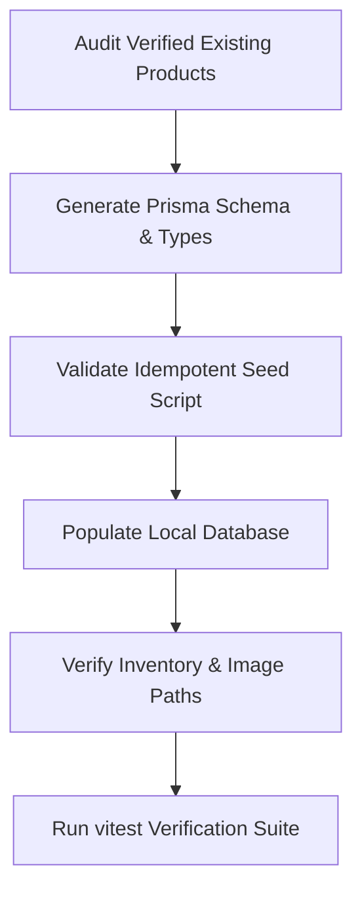

# KAVISH 2.0 — Database Architecture & Migration Plan

**Document Version:** 1.0  
**Target Environment:** Local Development & Staging  
**Primary Database:** Supabase PostgreSQL / Local PostgreSQL via Prisma ORM  

---

## 1. Principles of Data Preservation

1. **Zero Destructive Operations:** Never run `DROP TABLE CASCADE`, `TRUNCATE`, or database reset commands against the production Supabase database.
2. **Preserve Existing Identifiers:** Existing product IDs (e.g. `prod-1787822818531`), order IDs (e.g. `KV-ORD-83921`), category IDs, and SKUs (e.g. `KV-RPTS`, `KV-RPCS`) must be preserved exactly to maintain invoice integrity, order tracking, and SEO URL equity.
3. **Preserve Media Links:** All product image arrays referencing local high-resolution assets (`/assets/products/product_img_X.jpg`) or Supabase storage paths must be retained without breaking asset links.
4. **Isolated Local/Staging Environment:** All migration scripts, schema tests, and seed executions must run against a local or staging database first before applying changes to any live environment.

---

## 2. Table-by-Table Schema Mapping

The existing database schema in `supabase_schema.sql` maps directly to modern Prisma models:

### 2.1 Products (`public.products` -> Prisma `Product`)
| Existing SQL Column | Prisma Type | Mapping / Transformation Rule |
| :--- | :--- | :--- |
| `id` (TEXT, PK) | `String @id` | Retain original IDs (`prod-XXXXXX`) |
| `name` (TEXT) | `String` | Product title |
| `subtitle` (TEXT) | `String?` | Secondary promotional tagline |
| `category` (TEXT) | `String` | Department code: `women`, `men`, `kids` |
| `subcategory` (TEXT) | `String` | e.g. `Kasavu Sarees`, `Set Mundu`, `Linen Shirts` |
| `collection` (TEXT) | `String?` | Collection slug e.g. `kasavu-masterpieces` |
| `price` (NUMERIC) | `Decimal / Float` | Current selling price (INR) |
| `original_price` (NUMERIC) | `Decimal? / Float?` | MSRP / Strike-through price |
| `cost_price` (NUMERIC) | `Decimal? / Float?` | Internal cost for margin calculations |
| `discount_percentage` (NUMERIC) | `Float?` | Precomputed or dynamic percentage |
| `rating` (NUMERIC, default 5.0) | `Float` | Average customer review score |
| `review_count` (INTEGER, default 0) | `Int` | Count of verified reviews |
| `in_stock` (BOOLEAN, default true) | `Boolean` | Availability flag |
| `stock_count` (INTEGER, default 10) | `Int` | Physical inventory count |
| `low_stock_threshold` (INT, def 5) | `Int` | Alert threshold for reordering |
| `allow_backorders` (BOOLEAN) | `Boolean` | Allow purchases when stock is zero |
| `brand` (TEXT) | `String` | Default: `Kavish Kuthampully Atelier` |
| `is_new`, `is_best_seller`, `is_featured` | `Boolean` | Curated showcase flags |
| `images` (JSONB) | `Json` | Array of image URLs/paths |
| `sizes` (JSONB) | `Json` | Array of size labels (e.g. `['Free Size']`, `['38', '40']`) |
| `colors` (JSONB) | `Json` | Array of `{ name, hex }` objects |
| `variants` (JSONB) | `Json` | Detailed SKU/size/color inventory items |
| `fabric` (TEXT) | `String` | Fabric composition (e.g. `100% Organic Cotton & 24k Zari`) |
| `details` (JSONB) | `Json` | Array of bulleted features & GI tag data |
| `care_instructions` (JSONB) | `Json` | Array of wash & care notes |
| `fit_information` (TEXT) | `String?` | Silhouette details |
| `sku` (TEXT UNIQUE) | `String @unique` | Atelier SKU identifier |
| `tags` (JSONB) | `Json` | Search and categorization tags |
| `size_chart` (JSONB) | `Json?` | Dimensions and size specifications table |
| `created_at`, `updated_at` | `DateTime` | Timestamps |

### 2.2 Categories (`public.categories` -> Prisma `Category`)
| Existing SQL Column | Prisma Type | Purpose |
| :--- | :--- | :--- |
| `id` (TEXT, PK) | `String @id` | Category identifier (e.g. `cat-women-kasavu`) |
| `name` (TEXT) | `String` | Display title |
| `parent_category` (TEXT) | `String` | `women`, `men`, or `kids` |
| `slug` (TEXT UNIQUE) | `String @unique` | URL slug (e.g. `kasavu-sarees`) |
| `image` (TEXT) | `String?` | Representative photography |
| `description` (TEXT) | `String?` | Editorial category description |
| `seo_title`, `seo_description` | `String?` | Meta tags |
| `status` (TEXT) | `String` | `Active` or `Disabled` |
| `product_count` (INTEGER) | `Int` | Dynamic count of assigned items |

### 2.3 Orders (`public.orders` -> Prisma `Order`)
| Existing SQL Column | Prisma Type | Purpose |
| :--- | :--- | :--- |
| `id` (TEXT, PK) | `String @id` | Order ID (e.g. `KV-ORD-83921`) |
| `invoice_id` (TEXT) | `String?` | Formal invoice number (`KV-INV-2026-XXXXX`) |
| `date` (TEXT / TIMESTAMPTZ) | `DateTime / String`| Date placed |
| `status` (TEXT) | `String` | Pipeline stage: `New Order`, `Confirmed`, `Processing`, `Packed`, `Shipped`, `Delivered`, `Cancelled` |
| `payment_status` (TEXT) | `String` | `Pending`, `Paid`, `Failed`, `Refunded` |
| `items` (JSONB) | `Json` | Array of order items with price, quantity, size, color |
| `subtotal`, `discount`, `shipping_fee`, `total` | `Decimal / Float` | Order financial amounts |
| `cgst_amount`, `sgst_amount`, `igst_amount` | `Decimal? / Float?`| Tax split |
| `shipping_address` (JSONB) | `Json` | Name, phone, street, city, state, 6-digit PIN |
| `payment_method` (TEXT) | `String` | `Razorpay`, `Direct UPI`, `COD` |
| `tracking_number` (TEXT) | `String?` | Courier tracking AWB number |
| `courier_provider` (TEXT) | `String?` | Courier partner name |
| `estimated_delivery` (TEXT) | `String?` | Estimated arrival window |

---

## 3. Data Extraction & Seeding Strategy

All existing products, categories, reviews, and CMS configurations have been verified in the codebase. To guarantee zero data loss:

1. **Master Catalog Seed Source:**
   - Primary: `src/data/products.ts` (8 verified baseline products with local images).
   - Augmented: `src/data/custom_products.json` (9 custom products).
   - Combined deduplicated dataset: 10 unique handloom master garments.
2. **Category Seed Source:**
   - Extracted from `src/data/categories.ts`, cleaned of excessive raw base64 data, and mapped to `/assets/categories/` high-resolution photos.
3. **Heritage & Content Seed Source:**
   - Extracted from `src/data/heritage.ts` and `src/config/policyConfig.ts`.
4. **Seed Execution Tool:**
   - A standalone Node/TypeScript seed script will populate the database tables with all existing items using an idempotent upsert (`onConflictDoUpdate`) method.

---

## 4. Migration Execution Steps

1. **Step 1:** Establish Prisma Schema with strict types and JSON validations.
2. **Step 2:** Execute local seed script to load all 10 master products, 4 categories, 3 collections, and store configuration.
3. **Step 3:** Run automated test assertions to verify that every product ID, SKU, price, and image path is intact.
4. **Step 4:** Ensure frontend and admin APIs read directly from the seeded database.
